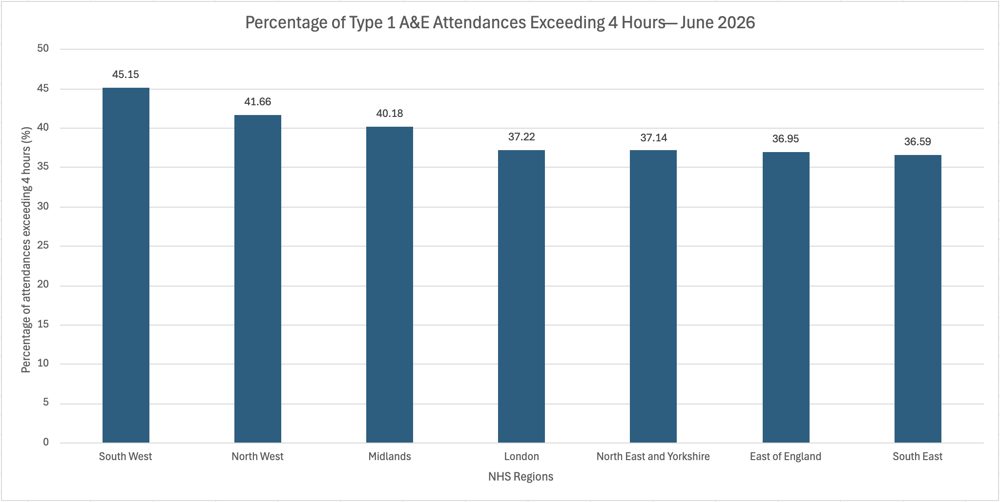

# NHS England A&E Waiting Time Analysis — June 2026

## Project Overview

This project analyses NHS England Accident & Emergency (A&E) attendance and waiting-time data for June 2026 using SQL.

The analysis focuses on Type 1 A&E attendances and regional differences in the proportion exceeding four hours.

## Tools Used

- SQLite
- DB Browser for SQLite
- SQL

## Dataset

Source: NHS England — A&E Attendances and Emergency Admissions, June 2026.

The dataset contains 193 records, including one national summary row and 192 organisation-level records across seven NHS regions.

[Official NHS England A&E dataset — June 2026](https://www.england.nhs.uk/statistics/statistical-work-areas/ae-waiting-times-and-activity/ae-attendances-and-emergency-admissions-2026-27/)

## Data Quality Checks

The analysis checks for missing values, zero and negative attendance counts, invalid waiting-time counts, and organisation-code completeness.

## Key Findings

- Total Type 1 A&E attendances: **1,459,491**
- Attendances exceeding four hours: **569,187**
- National percentage exceeding four hours: **39.00%**
- Highest regional percentage: **South West (45.15%)**
- Lowest regional percentage: **South East (36.59%)**
- Difference between highest and lowest: **8.56 percentage points**

### Regional Waiting-Time Comparison

| NHS Region | Total Type 1 Attendances | Over 4 Hours | Percentage Over 4 Hours |
|---|---:|---:|---:|
| South West | 132,047 | 59,620 | 45.15% |
| North West | 207,819 | 86,577 | 41.66% |
| Midlands | 277,940 | 111,669 | 40.18% |
| London | 238,284 | 88,697 | 37.22% |
| North East and Yorkshire | 233,419 | 86,695 | 37.14% |
| East of England | 157,503 | 58,193 | 36.95% |
| South East | 212,479 | 77,736 | 36.59% |

**Key observation:** The South West had the highest proportion of Type 1 attendances exceeding four hours, despite having the lowest total Type 1 attendance count among the seven regions.

These findings describe regional waiting-time differences, not their underlying causes.

## Regional Waiting-Time Visualisation

## SQL Files

- `01_data_exploration.sql` — Initial data exploration
- `02_data_quality_checks.sql` — Data quality validation
- `03_waiting_time_analysis.sql` — National and regional waiting-time analysis

## Project Status

Initial SQL exploration, quality checks, and regional waiting-time analysis completed. Further analysis and visualisations are planned.

## How to Reproduce the Analysis

1. Download the June 2026 A&E attendance CSV from the official NHS England dataset page.
2. Open DB Browser for SQLite and create a new database.
3. Import the CSV using File > Import > Table from CSV file.
4. Name the imported table `nhs_ae_june_2026`.
5. Ensure the first CSV row is used as the column headers.
6. Verify that the imported table contains 193 records.
7. Run the SQL scripts in the following order:
   - `01_data_exploration.sql`
   - `02_data_quality_checks.sql`
   - `03_waiting_time_analysis.sql`

The analysis excludes the national `TOTAL` summary row from calculations to avoid double-counting.

